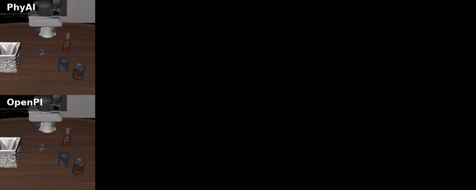
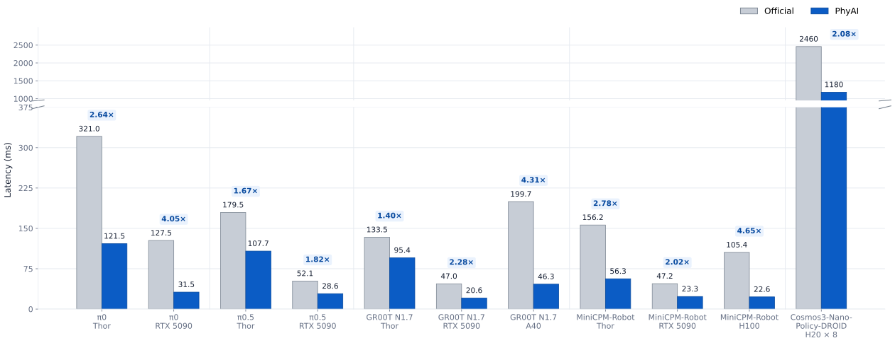

<p align="center">
  <picture>
    <source media="(prefers-color-scheme: dark)" srcset="docs/logo/dark.png">
    <source media="(prefers-color-scheme: light)" srcset="docs/logo/light.png">
    
  </picture>
</p>

# Anonymous review artifact

The `phyai` packages provide an inference and serving engine for physical AI
models, including policy and action models used in interactive systems.

<p align="center">
  
</p>

## Key Features

- Runs on NVIDIA Jetson edge devices
- Scales to GPU clusters with DP, TP, and CFG parallelism
- Uses high-performance kernels from FlashInfer and Humming
- Supports INT4, INT8, FP8, MXFP4, and NVFP4 quantization through [kernel policies](#quantization)

## Supported Models

<table align="center" width="100%">
  <tbody>
    <tr>
      <th align="center" width="22%">VLA</th>
      <td align="center">
        <a href="docs/models/pi0/ws1.mdx"><strong>&pi;0</strong></a>,
        <a href="docs/models/pi05/ws1.mdx"><strong>&pi;0.5</strong></a>,
        <a href="docs/models/gr00t/ws1.mdx"><strong>GR00T N1.7</strong></a>,
        <a href="examples/minicpm_gr00t/README.md"><strong>MiniCPM-Robot</strong></a>,
        <a href="docs/models/molmoact2/inference.mdx"><strong>MolmoAct2</strong></a>,
        <a href="docs/models/lingbot_v2/inference.mdx"><strong>LingBot V2</strong></a>
      </td>
    </tr>
    <tr>
      <th align="center" width="22%">WAM</th>
      <td align="center">
        <a href="docs/models/cosmos/policy.mdx"><strong>Cosmos3-Nano-Policy-DROID</strong></a>(w/ TP, CFG Parallel),
        <a href="docs/models/dreamzero/ws1.mdx"><strong>DreamZero</strong></a>,
        <a href="docs/models/humanwam-goal/inference.mdx"><strong>HumanWAM-Goal</strong></a>,
        <a href="docs/models/vpp2/inference.mdx"><strong>VPP2</strong></a>
      </td>
    </tr>
    <tr>
      <th align="center" width="22%">Foundation Model</th>
      <td align="center">
        <a href="docs/models/cosmos/generation.mdx"><strong>Cosmos3-Nano</strong></a>(w/ TP, CFG Parallel),
        <a href="docs/models/cosmos/generation.mdx"><strong>Cosmos3-Super</strong></a>(w/ TP, CFG Parallel),
        <a href="phyai/src/phyai/models/qwen3_5"><strong>Qwen3.5</strong></a>,
        <a href="phyai/src/phyai/models/qwen3_vl"><strong>Qwen3-VL</strong></a>,
        <a href="docs/models/qwen-image/generation.mdx"><strong>Qwen-Image 2.1</strong></a>,
        <a href="docs/models/xiaomi-u0/text-to-image.mdx"><strong>Xiaomi Robotics U0</strong></a> (T2I, X2I)
      </td>
    </tr>
  </tbody>
</table>

All supported models can scale through data-parallel (DP) replicas using the
shared scheduler. See [parallel serving](docs/deployment/parallel-serving.mdx#serving-replicas).

## Performance Comparison

<p align="center">
  
</p>

## Installation

See the [installation guide](docs/index.mdx) for prerequisites. From the root
of the provided repository, install the workspace packages:

```bash
uv sync
```

**AMD ROCm (experimental):** see the [AMD ROCm guide](docs/deployment/amd-rocm.mdx).

## Quantization

PhyAI supports post-training quantization (PTQ) when loading an unquantized
checkpoint. One **kernel policy YAML** controls which layers are quantized,
their weight and activation precision, and the execution kernels. Humming is
included in the standard installation.

For example, run PI0.5 with INT4 weights and BF16 activations (**W4A16**, NVIDIA
SM80+) from the repository root, with your PhyAI Python environment activated:

```bash
PHYAI_KERNEL_CONFIG=examples/pi05/kernel_policies/humming_w4a16.yaml \
python examples/pi05/run_pi05.py --checkpoint /path/to/pi05_base
```

This preset quantizes the language model and action expert's attention/MLP
linear projections with group size 128. Vision and input/output heads keep their
original precision. Point `--checkpoint` to your original, unquantized weights.

Choose another [PI0.5 preset](examples/pi05/kernel_policies), or copy one and edit
its `quantization` and kernel `rules`. See the
[quantization guide](docs/quantization/overview.mdx) for matching
layers, changing precision, and selecting kernels.

## Multi-host serving

You can run model servers on separate machines and connect them through
`phyai-gateway`. On each model host, prepare `pi05.yaml` with that host's
checkpoint, tokenizer, and robot settings. You can start from the
[PI0.5 example](examples/pi05/server.yaml), which serves `pi05` on port `50063`.
Check the configuration, then start the server:

```bash
phyai server pi05.yaml
```

On the gateway host, register both servers at startup. Replace the IP addresses
below with your server hosts; `pi05` must match `server.model_name` in their YAML
files. Repeat `--backend MODEL HOST:PORT` to add more servers:

```bash
phyai-gateway \
  --backend pi05 10.0.0.11:50063 \
  --backend pi05 10.0.0.12:50063
```

In another terminal on the gateway host, check that the backends report
`healthy: true`:

```bash
curl http://127.0.0.1:30000/v1/backends
```

Clients use the gateway host's HTTP port `30000` or gRPC port `50111`. The gateway
distributes stateless requests across healthy replicas. See the
[server and gateway setup guide](docs/deployment/server-gateway.mdx) for client
configuration and adding or removing servers while the gateway is running.

## License

PhyAI is released under the [MIT License](LICENSE). It uses [FlashInfer](https://github.com/flashinfer-ai/flashinfer), [Humming](https://github.com/inclusionAI/humming), and [FLA](https://github.com/fla-org/flash-linear-attention). We have also learned a great deal from [SGLang](https://github.com/sgl-project/sglang), [vLLM](https://github.com/vllm-project/vllm), and [TokenSpeed](https://github.com/lightseekorg/tokenspeed). We thank the maintainers and contributors of all these projects.
